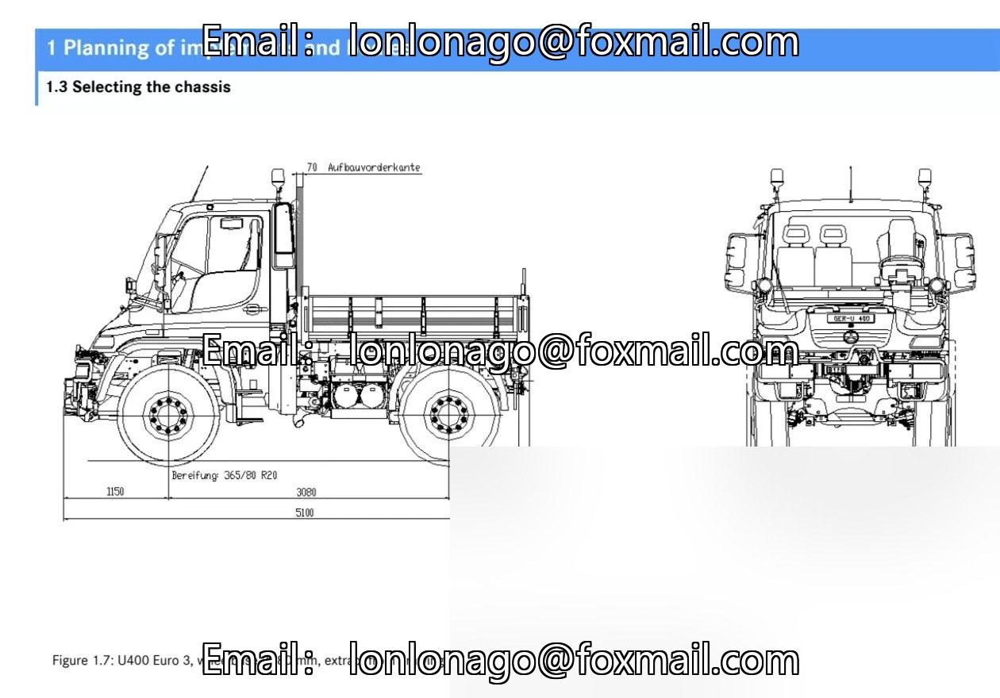
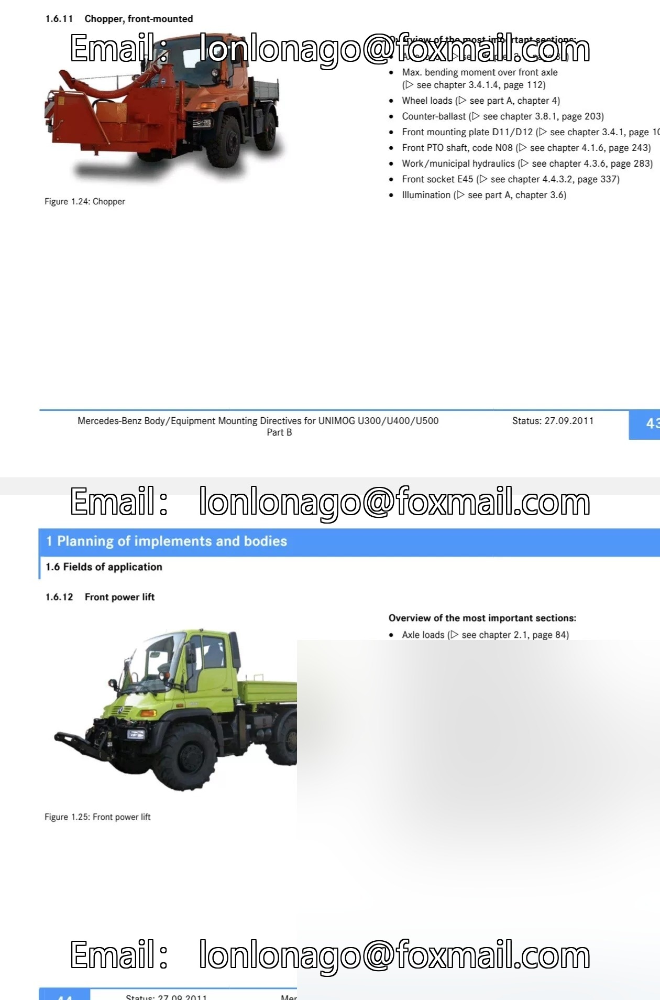
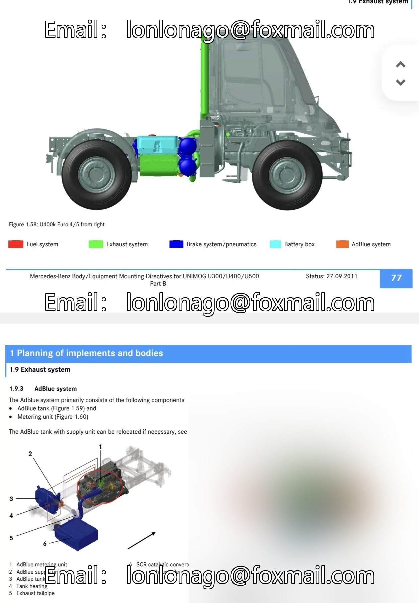
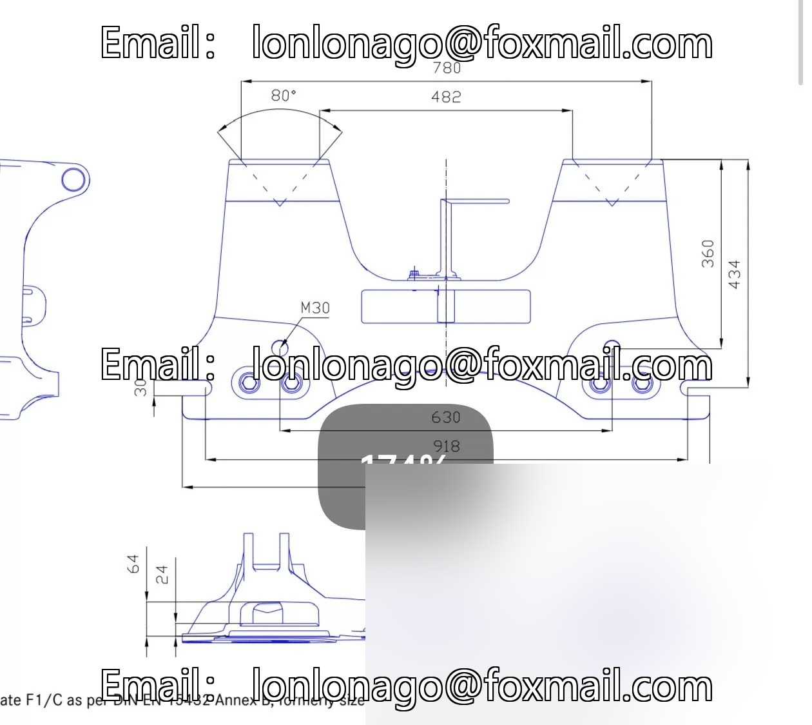

# Mercedes-Benz UNIMOG "Cabin and Equipment Installation Guide"

## Body

Mercedes-Benz UNIMOG (UNIMOG) 《Installation Guide for Cabin and Equipment》 electronic file PDF version 440 pages.
Applicable to U300, U400, and U500 three model series
Core use: The main purpose of this document is to provide technical standards, installation specifications, and safety requirements that must be followed when installing various professional bodies (such as fire tanks, cranes, and cargo boxes) or specialized equipment (such as drilling rigs, snow shoveling equipment) on the UNIMOG chassis to the vehicle modification factory, equipment installation manufacturer, or professional users. It ensures that the modified vehicle complies with the original Mercedes-Benz standards in terms of structure, safety, and functionality.

The document covers technical standards, installation specifications and safety requirements for installing professional body parts and specialized equipment on the UNIMOG chassis across U300, U400 and U500 vehicle series, including planning of implements and bodies and chassis selection.

<!-- AI_ENRICHED -->

## Images

## Payment

Here is a pay link on Stripe ( https://buy.stripe.com/3cs8yP7sY87d0vu9AB ). Please contact me lonlonago@foxmail.com after funding $89, and I will send you a complete data files , thank you!

